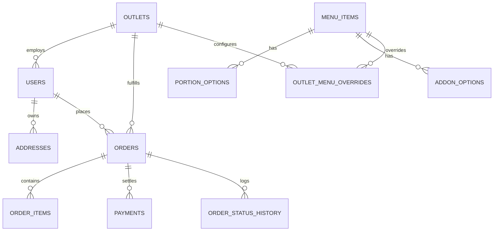

# Technical Design Document (TDD)
## Nawaab's Biryani Co. Direct Ordering Platform & Kitchen Display System (KDS)

**Repository URL:** https://github.com/company-a/hyderabad-biryani-kds  
**System Architecture:** Modular Monolith (FastAPI + React 18 + PostgreSQL + scikit-learn)  
**Client:** Company A, Hyderabad (14 Physical Outlets + 3 Cloud Kitchens, 520 Staff)  
**Annual Revenue:** ₹90–105 Crore (55% via third-party aggregators)

---

## 1. Executive Summary & Economic Model

### 1.1 The Business Problem
Third-party delivery aggregators charge **27% average commissions** on ₹52.8 Crore in annual aggregator sales. Furthermore, aggregators hold customer identity data, outlet billing systems are disconnected, and manual phone lines miss valuable catering orders.

### 1.2 Mathematical Proof of ₹1.14 Crore Annual Savings
$$\text{Aggregator Sales} = 55\% \times ₹96,00,00,000 = ₹52,80,00,000$$

1. **Direct Ordering Shift (12% of app orders):**
   $$\text{Direct Sales Volume} = 12\% \times ₹52,80,00,000 = ₹6,33,60,000$$
   $$\text{Commission Differential} = 27\% (\text{Aggregator}) - 12\% (\text{Payment + Fleet Delivery}) = 15\%$$
   $$\text{Direct Commission Savings} = 15\% \times ₹6,33,60,000 = ₹95,04,000 \text{ per year}$$

2. **Catering Phone-Line Leakage Recovery:**
   $$\text{Lost Orders} = 30 \text{ orders/month} \times ₹18,000 = ₹5,40,000/\text{month}$$
   $$\text{Gross Margin} = 30\% \implies \text{Margin per Order} = ₹5,400$$
   $$\text{Annual Catering Recovery} = 30 \times ₹5,400 \times 12 = ₹19,44,000 \text{ per year}$$

$$\mathbf{\text{Total Net Bottom-Line Profit Increase}} = ₹95,04,000 + ₹19,44,000 = \mathbf{₹1,14,48,000 \text{ per year (~₹1.14 Crore)}}$$

---

## 2. System Architecture & Boundaries

```mermaid
flowchart TD
    subgraph ClientLayer ["Client Layer"]
        CUST["Mobile Customer Web App (React + Vite)"]
        KDS["Outlet Kitchen Android Tablet (KDS)"]
        ADMIN["Operations Admin Console"]
    end

    subgraph APILayer ["FastAPI Gateway & Real-time Layer (Port 8000)"]
        AUTH["/api/auth (JWT & RBAC)"]
        MENU["/api/menu (Outlet-Aware Catalog)"]
        ORDERS["/api/orders (Authoritative Pricing & GST)"]
        PAY["/api/payments (Idempotent Sim)"]
        WS["/ws/kds/{outlet_id} (WebSocket Hub)"]
        ML_SERV["AI Prep-Time & Reorder Engine"]
    end

    subgraph DataLayer ["Data & Storage Layer"]
        PG[("PostgreSQL 16 (Docker)")]
        ML_WEIGHTS["scikit-learn Model Weights (.joblib)"]
    end

    CUST -->|REST / JSON| AUTH
    CUST -->|REST / JSON| MENU
    CUST -->|REST / JSON| ORDERS
    CUST -->|REST / JSON| PAY

    KDS <-->|WebSockets (Bidirectional)| WS
    KDS -->|REST Status Transition| ORDERS

    ADMIN -->|REST / CMS Control| MENU
    ADMIN -->|REST / Monitoring| ORDERS

    ORDERS -->|In-Process Infer| ML_SERV
    ML_SERV -->|Load Weights| ML_WEIGHTS

    AUTH --> PG
    MENU --> PG
    ORDERS --> PG
    PAY --> PG
```

### 2.1 Why a Modular Monolith?
- **Zero Network Serialization Overhead:** All 17 outlets, catalog CMS, order processing, and ML inference run within a unified high-performance Python ASGI runtime (FastAPI).
- **Atomic Transactions:** Order creation, line item snapshotting, and payment ledgering occur within atomic PostgreSQL transactions (`session.begin()`), preventing partial states.
- **Fast Local Development & Auditability:** The entire system starts locally in seconds via Docker Compose and standard package managers.

---

## 3. Data Model & Non-Negotiable Invariants

### 3.1 Entity-Relationship Overview



### 3.2 Non-Negotiable Invariants Implementation
1. **Authoritative Backend Pricing (AGENTS.md Invariant 1):**
   - The frontend never submits pricing or totals.
   - The backend looks up `menu_items.base_price`, adds `portion_options.price_modifier`, adds active `addon_options.price`, and multiplies by quantity.
2. **GST 5% Calculation Rule (AGENTS.md Invariant 2):**
   - All customer-facing prices are strictly inclusive of 5% GST.
   - Formula:
     $$\text{gst\_amount} = \text{round}\left(\frac{\text{inclusive\_amount} \times 5}{105}, 2\right)$$
   - Verified by unit and integration tests across orders.
3. **Historical Snapshot Immutability (AGENTS.md Invariant 4):**
   - `order_items` stores frozen columns: `item_name`, `portion_name`, `unit_price`, `quantity`, `addon_details`, and `total_price`.
   - Subsequent price updates or deletions in `menu_items` never alter historical order records.
4. **Idempotent Payment & Kitchen Dispatch (AGENTS.md Invariant 5):**
   - Payment endpoint requires an `idempotency_key`.
   - Orders enter `PLACED` state and dispatch to kitchen screens **only after payment succeeds**.
5. **KDS State Machine Transition Rule (AGENTS.md Invariant 6):**
   - Valid lifecycle: `PLACED` $\rightarrow$ `ACCEPTED` $\rightarrow$ `PREPARING` $\rightarrow$ `READY` $\rightarrow$ `HANDED_TO_RIDER`.
   - Backward transitions or arbitrary jumps are rejected with HTTP 400.
6. **DPDP Act 2023 Compliance:**
   - Explicit marketing & WhatsApp order notification opt-in checkbox at checkout.
   - Strict server-side RBAC: Customers only access their own orders; Kitchen staff access their outlet; Admins access the entire network.

---

## 4. 17 Outlets Network Architecture

The chain operates 14 physical dine-in flagships and 3 cloud kitchens across Hyderabad:

| # | Slug | Outlet Name | Type | Latitude | Longitude | Radius | Min Prep | FSSAI License |
|---|------|-------------|------|----------|-----------|--------|----------|---------------|
| 1 | `out-kondapur` | Kondapur Flagship Dine-In | PHYSICAL_DINEIN | 17.4622 | 78.3568 | 6.5 km | 30m | 13621014000412 |
| 2 | `out-charminar` | Charminar Heritage Dine-In | PHYSICAL_DINEIN | 17.3616 | 78.4747 | 5.0 km | 35m | 13619011000109 |
| 3 | `out-gachibowli`| Gachibowli Tech-Park Dine-In| PHYSICAL_DINEIN | 17.4435 | 78.3570 | 7.0 km | 25m | 13622014000881 |
| 4 | `out-jubilee` | Jubilee Hills Royal Courtyard| PHYSICAL_DINEIN | 17.4319 | 78.4073 | 6.0 km | 30m | 13620012000521 |
| 5 | `out-banjara` | Banjara Hills Nizami Hall | PHYSICAL_DINEIN | 17.4156 | 78.4357 | 6.0 km | 30m | 13620012000522 |
| 6 | `out-madhapur` | Madhapur HITEC Gateway | PHYSICAL_DINEIN | 17.4483 | 78.3915 | 6.0 km | 25m | 13621014000762 |
| 7 | `out-hitec` | HITEC City Cyber Towers | PHYSICAL_DINEIN | 17.4504 | 78.3808 | 5.5 km | 25m | 13621014000763 |
| 8 | `out-kukatpally`| Kukatpally Housing Board (KPHB)| PHYSICAL_DINEIN| 17.4933| 78.3995 | 6.5 km | 30m | 13621014000912 |
| 9 | `out-begumpet` | Begumpet Airport Road | PHYSICAL_DINEIN | 17.4448 | 78.4678 | 5.5 km | 28m | 13619011000305 |
| 10| `out-secunderabad`| Secunderabad Clock Tower | PHYSICAL_DINEIN | 17.4399 | 78.4983 | 6.0 km | 30m | 13619011000306 |
| 11| `out-mehdipatnam` | Mehdipatnam Junction | PHYSICAL_DINEIN | 17.3916 | 78.4419 | 5.5 km | 30m | 13620012000841 |
| 12| `out-tolichowki` | Tolichowki Arabian Oasis | PHYSICAL_DINEIN | 17.4018 | 78.4112 | 5.5 km | 30m | 13620012000842 |
| 13| `out-abids` | Abids Vintage Station | PHYSICAL_DINEIN | 17.3891 | 78.4739 | 5.0 km | 32m | 13619011000045 |
| 14| `out-himayatnagar`| Himayatnagar Central | PHYSICAL_DINEIN | 17.4042 | 78.4851 | 5.5 km | 28m | 13619011000046 |
| 15| `out-manikonda-ck`| Manikonda Dark Kitchen Station| CLOUD_KITCHEN | 17.4011| 78.3792 | 7.5 km | 22m | 13623014001102 |
| 16| `out-miyapur-ck` | Miyapur Metro Cloud Hub | CLOUD_KITCHEN | 17.4968 | 78.3614 | 7.5 km | 22m | 13623014001103 |
| 17| `out-uppal-ck` | Uppal Ring Road Cloud Kitchen| CLOUD_KITCHEN | 17.4056 | 78.5592 | 7.5 km | 24m | 13623014001104 |

### 4.1 Station Boundary & Overrides Solution
- **Haversine Geofencing:** Endpoint `/api/outlets/check-serviceability` calculates exact distance between customer GPS and outlet coordinates. Orders beyond delivery radius are blocked.
- **Station-Level Stock & Pit Overrides:** Heritage items requiring stone pits (e.g., *Pathar Ka Gosht*) are automatically flagged `is_available: false` with custom label `"Dine-In Stone Pit Only"` at cloud kitchens and express stations.

---

## 5. AI & Automation Architecture

### 5.1 Kitchen Prep-Time Regression Model
- **Algorithm:** scikit-learn `GradientBoostingRegressor` (100 estimators, max depth 4) persisted as `.joblib`.
- **Feature Vector:**
  1. `item_count`: Total items in the order.
  2. `sum_base_prep_minutes`: Raw sum of dish cooking weights.
  3. `active_kitchen_orders`: Number of active orders currently on dum (`PLACED`, `ACCEPTED`, `PREPARING`).
  4. `is_cloud_kitchen`: Boolean flag (Cloud kitchens exhibit faster throughput).
  5. `is_peak_hour`: Hyderabad lunch rush (12:30–15:00 IST) and dinner rush (19:30–22:30 IST).
- **Non-Negotiable Fallback Rule:**
  $$\text{promised\_prep\_time} = \max(\text{ai\_estimated\_time}, \text{outlet\_minimum\_prep\_time})$$
- If model inference fails or offline:
  $$\text{fallback\_time} = \text{base\_prep} + (\text{active\_load} \times 1.2) + (\text{item\_count} \times 1.5) + \text{peak\_boost}$$

### 5.2 AI Customer Reorder Suggestions
- Endpoint `/api/orders/reorder-suggestions` queries customer historical orders.
- Computes dish repeat frequencies and portions.
- Surfaced as recommendations on `/order`.
- **Safety Invariant:** Suggestions **never** add items to the cart automatically; the customer must explicitly tap "Add +".

### 5.3 Exception Handling & Late Order Alerts
- Orders exceeding promised time by >10 minutes trigger an automatic alert in the operations console and pulse in red on the KDS tablet.
- Station managers can override estimates directly from the console.

---

## 6. Real-Time Kitchen Display System (KDS)

### 6.1 Hardware & Environment Target
- Budget Android tablets (10-inch) mounted in hot, humid, noisy kitchen environments.
- High-contrast dark theme with large typography legible from 2 metres.
- 1-tap massive touch targets for staff wearing gloves.

### 6.2 WebSocket Resilience
- WebSocket endpoint `/ws/kds/{outlet_id}` receives live dispatches and status updates.
- Heartbeat ping-pong keeps connections alive.
- On reconnect, KDS performs a full REST reconciliation query against `/api/orders?outlet_id={id}` so tickets are never dropped.

---

## 7. Verification & Definition of Done

1. **Automated Unit & Integration Test Suite (`backend/tests/test_api_invariants.py`):**
   - `test_health_and_db_probes`: PASSED
   - `test_all_17_outlets_returned`: PASSED
   - `test_outlet_serviceability_haversine`: PASSED
   - `test_outlet_specific_menu_overrides`: PASSED
   - `test_authoritative_backend_pricing_and_gst_invariants`: PASSED
2. **TypeScript Build:**
   - `npm run build` passes with 0 lint or type errors.
3. **Zero-Emoji Policy:**
   - 100% vector SVG/Lucide icons across all screens.
